<div align="center">


# Taka Koi?

### Split trip expenses with friends. Everyone approves their own share, the app does the math, and it works with no signal.

*"Taka Koi?" means "Where's the money?" in Bengali* 😄

[](https://github.com/Crux-15/Taka-Koi-/releases/latest/download/Taka-Koi.apk)
[](https://taka-koi.pages.dev)

[](https://github.com/Crux-15/Taka-Koi-/releases/latest)


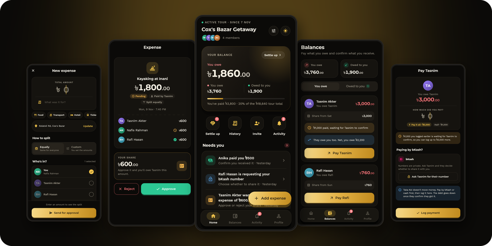

[The story](#-the-story) · [Highlights](#-highlights) · [Screenshots](#-screenshots) · [How it works](#-how-it-works) · [Under the hood](#-under-the-hood) · [Get the app](#-get-the-app) · [Roadmap](#-roadmap)

</div>

---

## 📖 The story

On a trip in the hills, we hit a problem every group knows. Someone paid for transport, someone paid for food, someone paid for the stay, and by the end nobody remembered who paid what.

A spreadsheet is not something you open on a hillside. And even when you do write everything down, you still have to calculate it all by hand, with plenty of room for miscalculation and misremembering.

So I built **Taka Koi?**: log an expense the moment it happens, let the app do the math, and let every friend confirm their own share so there are no surprises at the end of the trip.

It works offline, because trips don't promise good signal.

---

## ✨ Highlights

<table>
<tr>
<td width="33%" valign="top">

### 🤝 Nothing is a debt until you say yes
Each friend approves **only their own share**. Debts appear once everyone agrees, so nobody gets billed by surprise.

</td>
<td width="33%" valign="top">

### 📶 Works with no signal
Log expenses, approve shares and confirm payments **offline**. Everything syncs by itself when you're back online.

</td>
<td width="33%" valign="top">

### 🧮 Exact to the paisa
Money is counted in whole paisa, so shares **always add up** and debts settle to exactly zero.

</td>
</tr>
<tr>
<td valign="top">

### 💸 Settle up with bKash
Pay in full or in parts, and the person you paid **confirms they got it**. Ask a friend for their bKash number in one tap.

</td>
<td valign="top">

### 📱 Android and iPhone
A free Android app, and the **same app on iPhone** as a home-screen web app. No App Store needed.

</td>
<td valign="top">

### 🔐 Secure by design
The **database itself** enforces who can do what, so even a modified app can't approve someone else's share.

</td>
</tr>
</table>

---

## 📸 Screenshots

<div align="center">

<table>
<tr>
<td align="center"><br/><sub><b>Home</b><br/>Your balance and what needs you</sub></td>
<td align="center"><br/><sub><b>Log an expense</b><br/>Equal or custom split, GPS tagged</sub></td>
<td align="center">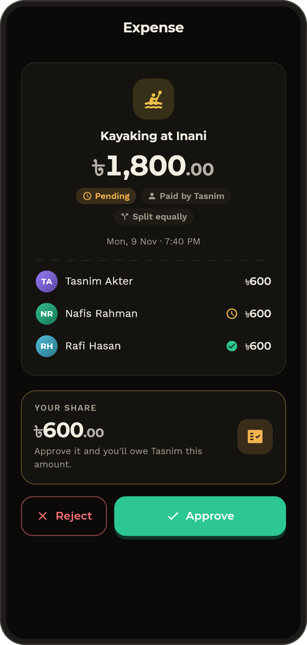<br/><sub><b>Approve your share</b><br/>Only you decide on yours</sub></td>
<td align="center">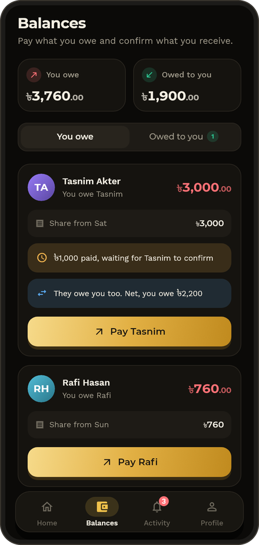<br/><sub><b>Balances</b><br/>Net amount per person</sub></td>
</tr>
<tr>
<td align="center">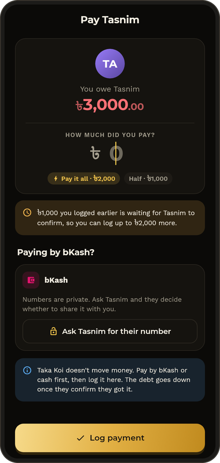<br/><sub><b>Pay</b><br/>Full or partial, bKash or cash</sub></td>
<td align="center">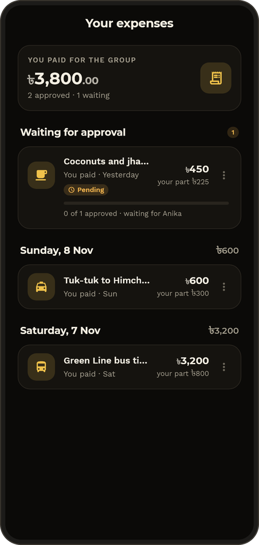<br/><sub><b>Your expenses</b><br/>See who has approved</sub></td>
<td align="center">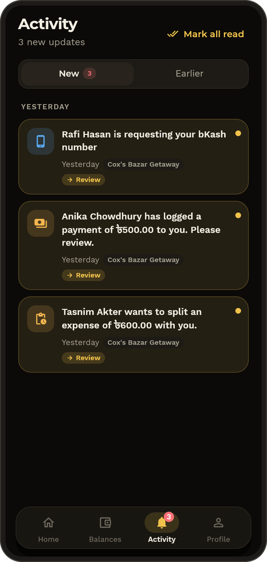<br/><sub><b>Activity</b><br/>Tap to act on any request</sub></td>
<td align="center">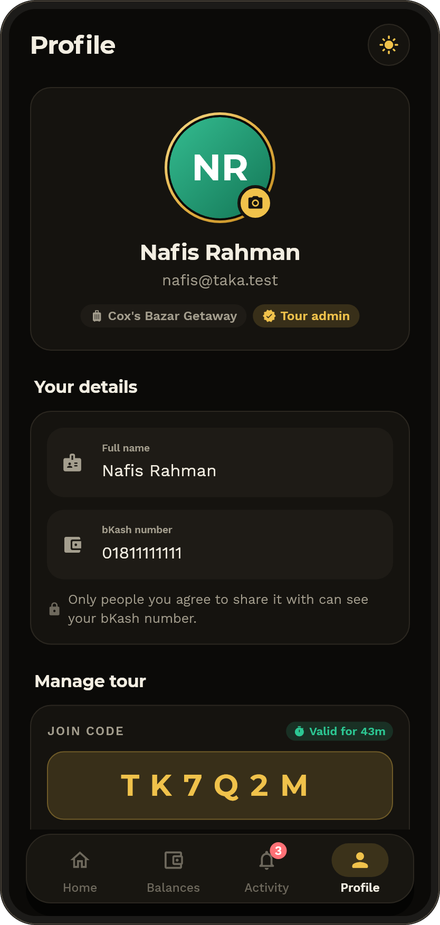<br/><sub><b>Profile</b><br/>Join code and private bKash number</sub></td>
</tr>
<tr>
<td align="center">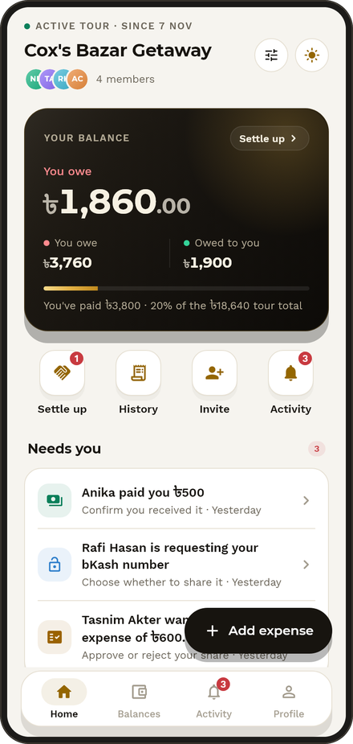<br/><sub><b>Light mode</b><br/>Both themes are first-class</sub></td>
<td align="center">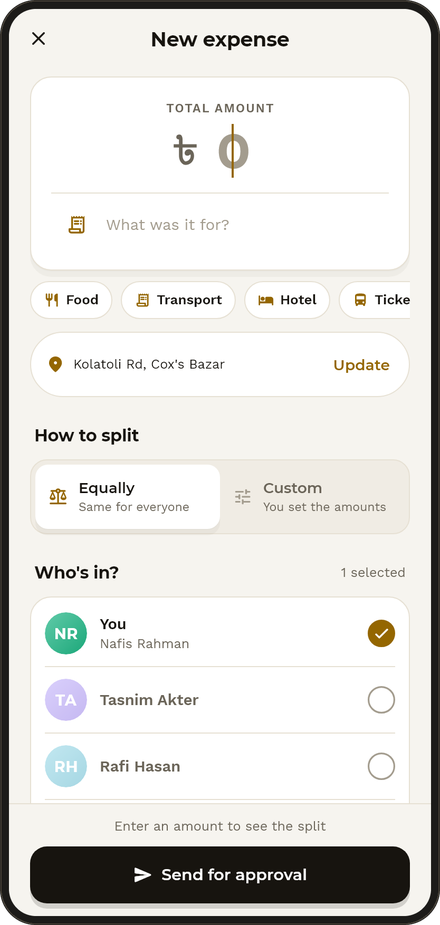<br/><sub><b>Log an expense</b><br/>Light mode</sub></td>
<td align="center">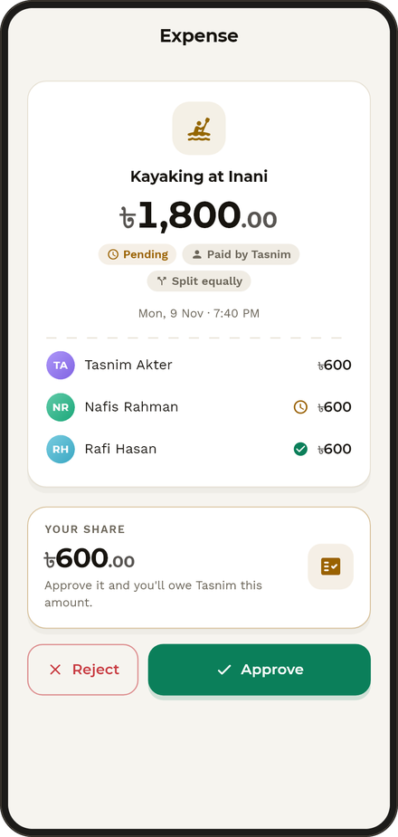<br/><sub><b>Approve</b><br/>Light mode</sub></td>
<td align="center">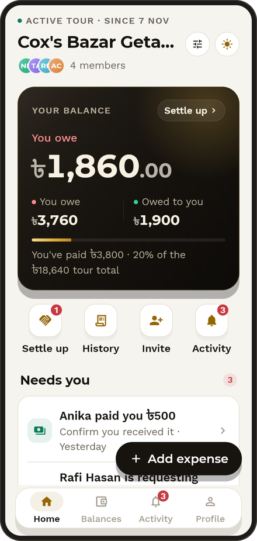<br/><sub><b>Large text</b><br/>Readable at 130% text size</sub></td>
</tr>
</table>

</div>

---

## 🔄 How it works

The core idea is **nothing becomes a debt until the right person says yes**.

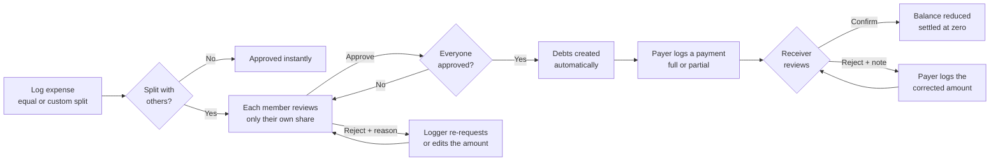

---

## 🚀 Features

<details open>
<summary><b>👥 Tour groups</b></summary>

- Create a tour, pick its currency (BDT, USD, EUR, GBP, INR, PKR, MYR or AED) and invite friends with a **6-character code**
- Join codes **expire after 1 hour** and the admin can refresh them, so a leaked code doesn't stay valid
- Admin tools: remove members who have no approved expenses, transfer admin rights, end the tour
- Members can ask to leave, and the admin approves
- Tours **end automatically after 4 days of inactivity**, checked against the server's clock
- Tour history with a per-member spending breakdown for every past tour

</details>

<details open>
<summary><b>💸 Expenses</b></summary>

- Log an amount and a note (with one-tap suggestions like Food, Transport or Hotel), and the **GPS location and a readable address** are captured automatically
- **Equal or custom split** between up to 50 people, with a live split preview
- **Consent-based approval:** every member reviews and approves only their own share
- Rejected a share? Add a reason, and the logger can ask again or (for custom splits) adjust the amount
- Once money has been paid against an expense, it can't be deleted
- Home feed with a live member ranking by total spent

</details>

<details open>
<summary><b>🏦 Debts and settlement</b></summary>

- Debts are created automatically once an expense is fully approved
- **I owe** and **Owed to me** tabs with a **net balance per person**
- Pay in full or **in parts**; the app blocks amounts above what's still owed, counting payments waiting for confirmation
- The person being paid **confirms or rejects** each payment, with a note
- **Settle up after the tour ends:** past tours show what you still owe or are owed, with Pay and Confirm right there
- You can't leave a tour while you still owe or are owed money there, so nobody is left with a debt they can't see

</details>

<details>
<summary><b>📲 bKash number sharing</b></summary>

- Ask a member for their bKash number right from the Pay screen
- They choose whether to share it, and can add one while accepting (checked as a valid 11-digit number)
- Once shared, the number appears with a **one-tap copy** button
- Numbers stay private: only the person who asked can read a shared number

> The app tracks and confirms who paid whom. The money itself moves through bKash or cash, outside the app.

</details>

<details>
<summary><b>🔔 Notifications, accounts and accessibility</b></summary>

- Real-time in-app notifications for approvals, rejections, payments, leave requests and bKash requests; tap one to jump straight to it
- **Google Sign-In**, or email sign-up confirmed through a verification link, with password reset
- Profile photos, light and dark themes, and a short "How Taka Koi works" guide for first-timers
- Works with larger phone text sizes (checked at 130%) and screen readers (labelled buttons)

</details>

---

## 🧠 Under the hood

Clean **MVC** with a dedicated service layer, so UI, state and data access stay separate. One Flutter codebase ships as the Android app and as the iPhone web app.

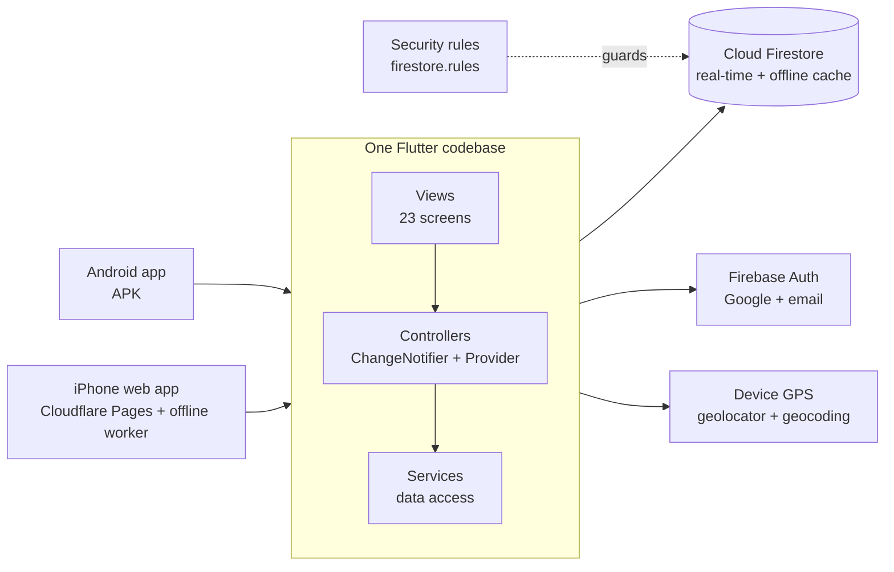

### Engineering highlights

| Challenge | How it's solved |
|---|---|
| **Trips have no signal** | Firestore offline persistence plus offline-first actions: approvals run as transactions when online and as queued writes when offline, with the security rules as the referee when they sync |
| **A modified app could cheat** | Every permission (approve only your own share, only the receiver confirms a payment, shares add up to the total) is enforced by **Firestore security rules**, not just the UI |
| **Two people approving at once** | Transactions, so approvals can't overwrite each other and a payment can't reduce a debt twice |
| **Rounding errors** | Whole-paisa integer maths; equal splits spread the odd paisa so shares always match the total |
| **iPhone without the App Store** | The same app as an installable web app: a versioned service worker keeps the app on the phone so it opens offline, and Google sign-in runs through the site's own address so Safari's privacy rules don't block it |
| **Zero running cost** | Firebase's free plan plus Cloudflare Pages; profile photos are shrunk to under 90 KB and stored in Firestore instead of paid file storage |
| **Leaked invite codes** | Join codes expire after an hour and live in their own collection, so outsiders never read a tour |
| **Trust** | Expense events go to an audit log with SHA-256 hashes |

<details>
<summary><b>Project structure</b></summary>

```
lib/
├── main.dart              # Firebase init, offline persistence, providers, theme
├── controllers/           # State and business logic
├── models/                # User, Group, Expense, Debt, Payment, Notification, bKash share
├── services/              # Firestore, Auth, profile photos, bKash sharing, GPS, offline actions
├── utils/                 # Router, theme, colours, money and split maths, offline helpers
├── views/                 # Screens, grouped by feature (auth, group, expenses, debts, profile, ...)
└── widgets/               # Design-system components and shared widgets
firestore.rules            # Database security rules
web/                       # Web app: icons, manifest, offline worker (sw.js)
cloudflare/functions/      # Website sign-in pass-through to Firebase (/__/auth)
tool/build_web.mjs         # Builds (and with --deploy publishes) the website
```

</details>

<details>
<summary><b>Firestore data model</b></summary>

```
users/{uid}                      # readable by its owner only
groups/{groupId}                 # members map + memberIds list
 ├── expenses/{expenseId}        # splits, per-member approvals, rejection reasons
 ├── debts/{expenseId_userId}    # original and remaining amount, status
 ├── payments/{paymentId}        # pending, approved or rejected
 ├── auditLog/{logId}            # SHA-256 hashed event records
 └── leaveRequests/{uid}
groupCodes/{code}                # join code → group, so outsiders never read groups
notifications/{notificationId}
bkashRequests/{groupId_requester_owner}
avatars/{uid}                    # profile photo, a small JPEG (≤90 KB)
```

</details>

<details>
<summary><b>Design system: "Obsidian & Gold"</b></summary>

Warm near-black and porcelain surfaces, one restrained gold accent, and clear money colours (green = owed to you, red = you owe, amber = waiting). Light and dark mode are both first-class.

| Piece | Where |
|---|---|
| Colours, resolved per light/dark mode via `context.palette` | `lib/utils/app_palette.dart`, `app_colors.dart` |
| Montserrat for headings and amounts, Work Sans for text (bundled, open-licensed) | `lib/utils/app_typography.dart`, `assets/fonts/` |
| Material theme for every standard widget | `lib/utils/app_theme.dart` |
| Components: `AppCard`, `MoneyText` (৳1,00,000.00 with tabular digits), `StatusChip`, `IconTile`, `SectionHeader`, `Skeleton`, `PillTabBar`, `FloatingNavBar`, `ExpenseTile`, `Pressable` | `lib/widgets/ui/` |

</details>

---

## 🧰 Tech stack

| Layer | Technology |
|---|---|
| App | Flutter and Dart: one codebase for Android and the web |
| State and navigation | Provider (`ChangeNotifier`), GoRouter with sign-in, email-verification and active-tour guards |
| Database | Cloud Firestore: real-time, offline-enabled, guarded by security rules |
| Sign-in | Firebase Auth: Google, and email and password with email verification |
| Web app | Installable web app with a custom service worker, hosted on Cloudflare Pages with Pages Functions |
| Device | `geolocator`, `geocoding`, `image_picker`, `connectivity_plus` |
| Utilities | `crypto`, `uuid`, `intl`, `shared_preferences`, `cached_network_image`, `url_launcher`, `image` |

**~16.6K lines of Dart** · 23 screens · 6 controllers · 9 services · 7 models

---

## 📲 Get the app

<table>
<tr>
<th width="50%">🤖 Android</th>
<th width="50%">🍏 iPhone</th>
</tr>
<tr>
<td valign="top">

No Play Store needed:

1. On your phone, open **[⬇️ Taka-Koi.apk](https://github.com/Crux-15/Taka-Koi-/releases/latest/download/Taka-Koi.apk)**
2. If asked, allow installs from your browser
3. Tap the downloaded file, then **Install**
4. Open **Taka Koi?** and sign in 🎉

<sub>"Install blocked"? Go to Settings → Security → Install unknown apps and allow your browser. The app asks for location (to tag expenses), photos (for your profile picture) and internet access.</sub>

</td>
<td valign="top">

No App Store needed:

1. Open **[taka-koi.pages.dev](https://taka-koi.pages.dev)** in **Safari**
2. Tap **Share**, then **Add to Home Screen**, then **Add**
3. Open **Taka Koi** from the new icon and sign in there 🎉

It opens full screen like an app and works offline once you've signed in. The icon keeps its own sign-in, separate from Safari.

<p align="center">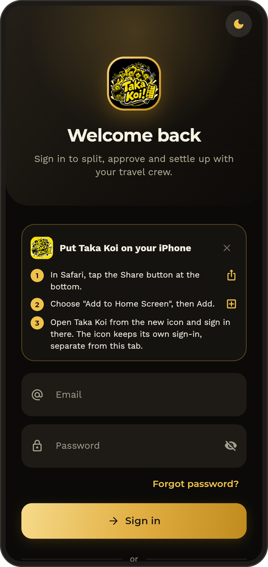</p>

</td>
</tr>
</table>

> **Updating from v1.0.0 on Android:** v1.1.0 is signed with a new key, so Android won't install it over the old version. Open the old app once while online (so anything logged offline syncs), uninstall it, then install v1.1.0 and sign in. Your tours are stored online, so nothing is lost.

---

## 🔒 Security

- **Firestore security rules are in this repository** ([`firestore.rules`](firestore.rules)). They enforce the permission model: members approve only their own shares and shares must add up to the total, debts are only created when an expense is finalised, only the receiver can confirm a payment, outsiders can't read tours, and bKash numbers are readable only by the person they were shared with
- Email accounts must confirm their address before they can read or write any tour data
- Firebase config files, signing keys and other secrets are kept out of version control

---

## 🔧 Build from source

<details>
<summary><b>Setup, release build and website deploy</b></summary>

> The source is public for review. Under the [proprietary license](LICENSE), running or reusing it beyond the released app needs the author's written permission.

**Prerequisites:** Flutter stable (Dart 3.12+), a JDK, a Firebase project with Firestore and Authentication (Google and Email/Password) on the free Spark plan, the [FlutterFire CLI](https://firebase.flutter.dev/docs/cli) and the [Firebase CLI](https://firebase.google.com/docs/cli).

```bash
git clone https://github.com/Crux-15/Taka-Koi-.git
cd Taka-Koi-
flutter pub get
flutterfire configure          # generates the git-ignored Firebase config
firebase deploy --only firestore:rules
flutter run
```

Add your debug SHA-1 to the Firebase Android app for Google Sign-In.

**Android release:** release builds are signed with your own key, read from a git-ignored `android/key.properties`, and refuse to build without it, so a debug-signed APK can't ship by mistake. Add the key's SHA-1 and SHA-256 to Firebase, bump `version:` in `pubspec.yaml`, then run `flutter build apk --release`.

**Website:** `node tool/build_web.mjs --deploy` builds the web app, stamps the offline worker with this build's files and publishes it to Cloudflare Pages (after `npx wrangler login`). For a new site address, add it to Firebase Auth's authorized domains and add `https://<site>/__/auth/handler` to the Google OAuth web client's redirect URIs.

</details>

---

## 🧭 Roadmap

- ✅ Offline approvals and payment confirmations
- ✅ iPhone version as a home-screen web app
- ⬜ Push notifications through Firebase Cloud Messaging (currently in-app only)
- ⬜ Debt simplification across the whole group to minimise the number of transfers
- ⬜ Cloud Functions for finalising expenses and ending idle tours on the server
- ⬜ Trip summary charts by category
- ⬜ Play Store release

---

## 👨‍💻 Author

**Sadman Sakib**, final-year CSE student at American International University-Bangladesh (AIUB)

[](https://github.com/Crux-15)
[](https://linkedin.com/in/sadmaan-sakib)

## 📄 License

**Proprietary software.** Copyright © 2025 Sadman Sakib. All rights reserved.
You may download and use the app for personal, non-commercial purposes. Copying, modifying or redistributing the source code is not permitted without written permission. See [LICENSE](LICENSE) for details.

---

<div align="center">

Made with 💛 for friends who travel together

<sub>Built with Flutter, Firebase and Claude Code</sub>

</div>
