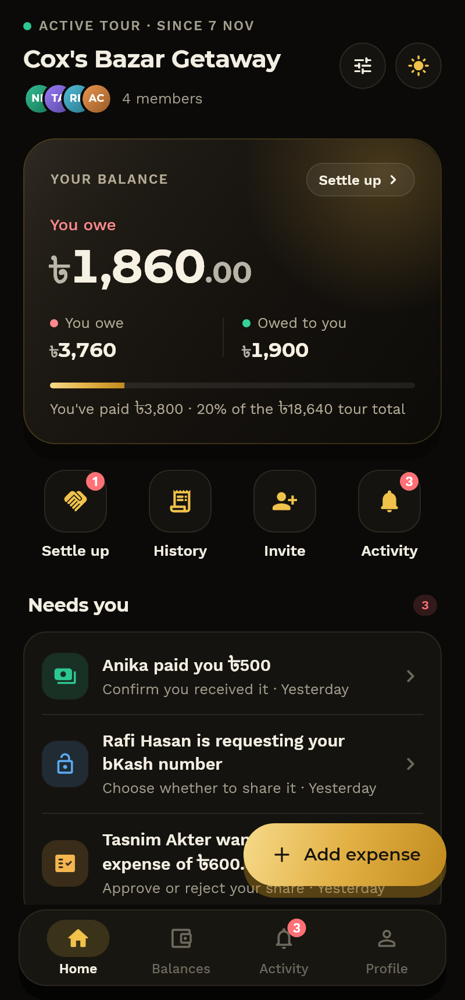
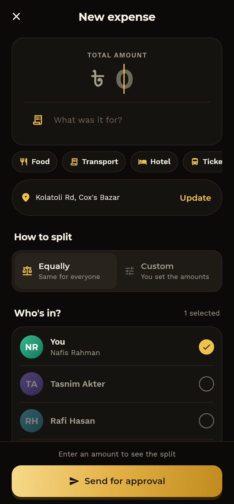
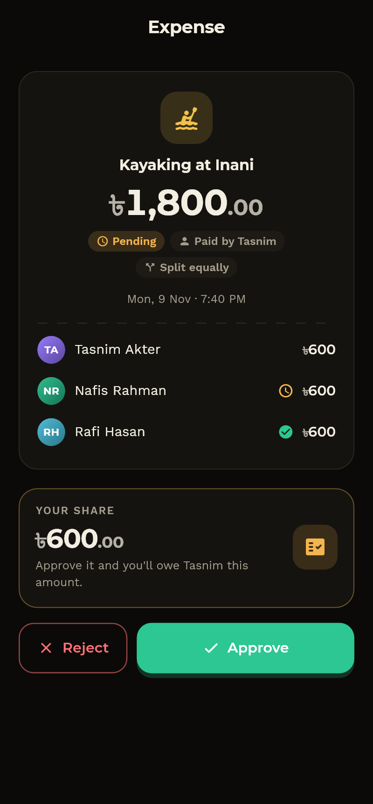
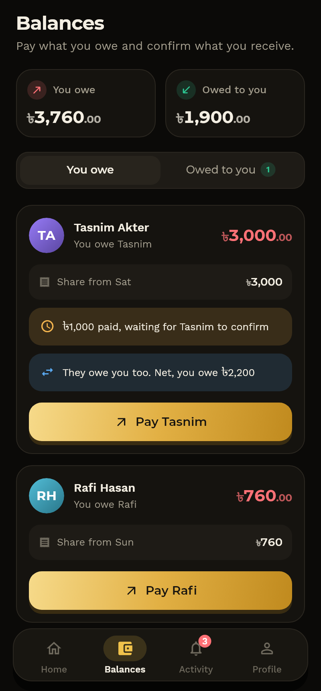
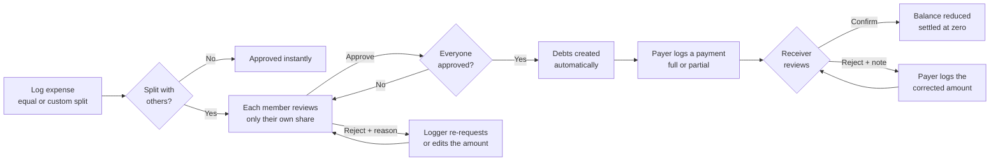
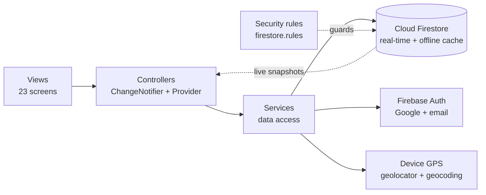

<div align="center">


# Taka Koi?

### Split trip expenses with friends. No spreadsheets. No mental math. No awkward conversations.

*"Taka Koi?" means "Where's the money?" in Bengali* 😄

[](https://github.com/Crux-15/Taka-Koi-/releases/latest/download/Taka-Koi.apk)


[The story](#-the-story) · [Features](#-features) · [How it works](#-how-it-works) · [Architecture](#-architecture) · [Install](#-install-on-android) · [Build from source](#-build-from-source) · [Roadmap](#-roadmap)

</div>

---

## 📖 The story

On a trip in the hills, we hit a problem every group knows. Someone paid for transport, someone paid for food, someone paid for the stay, and by the end nobody remembered who paid what.

A spreadsheet is not something you open on a hillside. And even when you do write everything down, you still have to calculate it all by hand, with plenty of room for miscalculation and misremembering.

So I built **Taka Koi?**: log an expense the moment it happens, let the app do the math, and let every friend confirm their own share so there are no surprises at the end of the trip.

It works offline, because trips don't promise good signal.

## 📸 Screenshots

| Home | Log expense | Approve a share | Balances |
|:---:|:---:|:---:|:---:|
|  |  |  |  |

---

## ✨ Features

### 👥 Tour groups
- Create a tour, pick its currency (BDT, USD, EUR, GBP, INR, PKR, MYR or AED) and invite friends with a **6-character code**
- Join codes **expire after 1 hour** and the admin can refresh them, so a leaked code doesn't stay valid
- Members join instantly with the code
- Admin tools: remove members who have no approved expenses, transfer admin rights, end the tour
- Members can request to leave, and the admin approves
- Tours **end automatically after 4 days of inactivity** (checked against the server's clock, and payments count as activity)
- Tour history with a per-member spending breakdown for every past tour

### 💸 Expenses
- Log an amount and a note, with **GPS location and a readable address** captured automatically
- **Equal split** or **custom split** between up to 50 people, with an option to include or exclude yourself and a live split preview
- Shares are worked out in whole paisa, so they always add up to the total exactly
- **Consent-based approval:** every member reviews and approves only their own share
- Rejected a share? Add a reason, and the logger can re-request it or (for custom splits) adjust the amount and ask again
- Deleting an expense is direct for the admin, and a request for everyone else. Once money has been paid against it, it can't be deleted
- Home feed with a live member ranking by total spent

### 🏦 Debts and settlement
- Debts are created automatically once an expense is fully approved
- **I owe** and **Owed to me** tabs with a **net balance per person**
- Pay in full or **in parts**. The app blocks amounts above what's still owed, counting payments that are waiting for confirmation
- The person being paid **confirms or rejects** each payment (with a note); after a rejection the payer logs the corrected amount
- A debt closes automatically when its balance reaches zero
- **Settle up after the tour ends:** past tours show what you still owe or are owed, with Pay and Confirm right there
- You can't leave a tour (or hide it) while you still owe or are owed money there, so nobody gets stranded with a debt they can no longer see

### 📲 bKash number sharing
- Ask a member for their bKash number inside the app, right from the Pay screen
- If they haven't added one, they add it while accepting (it's checked as a valid 11-digit number)
- Once they accept, the number appears with a **one-tap copy** button
- Numbers stay private: only the person who asked can read a shared number, and nobody can read another member's profile

> The app tracks and confirms who paid whom. The money itself moves through bKash or cash, outside the app.

### 🔔 Notifications
- Real-time in-app notifications for every action: approvals, rejections, payments, leave requests, bKash requests
- Tap a notification to jump straight to the item that needs your decision
- Unread badge on the navigation bar

### 🔐 Accounts and experience
- A short "How Taka Koi works" guide for people starting their first tour
- Works with larger phone text sizes (checked at 130%) and screen readers (labelled buttons)
- **Google Sign-In**, or email registration confirmed through a **Firebase verification link**, password setup and profile photo upload
- Forgot-password flow via Firebase
- Light and dark themes (remembered between launches)
- **Works offline:** logging an expense or a payment saves on the phone and syncs when you're back online. Approving needs a connection, and the app says so instead of spinning

---

## 🔄 How it works

The core idea is **nothing becomes a debt until the right person says yes**.



---

## 🏗️ Architecture

Clean **MVC** with a dedicated service layer, so UI, state and data access stay separate. The database enforces the same permission model through **Firestore security rules**, so a modified app can't get around it.



### Project structure

```
lib/
├── main.dart              # Firebase init, offline persistence, providers, theme
├── controllers/           # State and business logic
├── models/                # User, Group, Expense, Debt, Payment, Notification, bKash share
├── services/              # Firestore, Auth, profile photos, bKash sharing and GPS access
├── utils/                 # Router, theme, colours, constants, money and split maths, offline helpers
├── views/                 # Screens, grouped by feature
│   ├── auth/  splash/  group/  debts/  notifications/  shell/
│   ├── expenses/          # home_view.dart + home/ (its cards and sections)
│   └── profile/           # profile_view.dart + widgets/ (join code, invite sheet)
└── widgets/common/        # Reusable components (buttons, avatars, banners)
firestore.rules            # Database security rules
web/                       # Website: home-screen icon, manifest, offline worker (sw.js)
cloudflare/functions/      # Website sign-in pass-through to Firebase (/__/auth)
tool/build_web.mjs         # Builds (and with --deploy publishes) the website
```

### Firestore data model

```
users/{uid}                      # readable by its owner only
groups/{groupId}                 # members map + memberIds list
 ├── expenses/{expenseId}        # splits, per-member approvals, rejection reasons
 ├── debts/{expenseId_userId}    # original and remaining amount, status
 ├── payments/{paymentId}        # pending, approved or rejected
 ├── auditLog/{logId}            # SHA-256 hashed event records
 └── leaveRequests/{uid}
groupCodes/{code}                # join code → group, so outsiders never read groups
notifications/{notificationId}
bkashRequests/{groupId_requester_owner}
avatars/{uid}                    # profile photo, a small JPEG (≤90 KB)
```

### Design system

"Obsidian & Gold": warm near-black and porcelain surfaces, one restrained gold accent, and clear money colours (green = owed to you, red = you owe, amber = waiting). Light and dark mode are both first-class.

| Piece | Where |
|---|---|
| Colours (resolved per light/dark mode via `context.palette`) | `lib/utils/app_palette.dart`, raw values in `app_colors.dart` |
| Type: Montserrat for headings and amounts, Work Sans for text (bundled, open-licensed) | `lib/utils/app_typography.dart`, `assets/fonts/` |
| Material theme for every standard widget | `lib/utils/app_theme.dart` |
| Components: `AppCard`, `MoneyText` (৳1,00,000.00 with tabular digits), `StatusChip`, `IconTile`, `SectionHeader`, `Skeleton`, `PillTabBar`, `FloatingNavBar`, `ExpenseTile`, `Pressable` | `lib/widgets/ui/` |

### Engineering decisions

| Decision | Why |
|---|---|
| **Security rules in the database** | Every permission (approve only your own share, only the receiver confirms a payment, shares add up to the total, ...) is enforced by Firestore itself, so a modified app can't get around it |
| **Firestore offline persistence** | Logging works with no signal. Screens wait a few seconds for the server, then let the change sync in the background |
| **Transactions for approvals and settlement** | Two people approving at once can't overwrite each other, and a payment can't reduce a debt twice |
| **Whole-cent money maths** | Equal splits spread the odd paisa, so shares always add up and debts can be paid down to exactly zero |
| **Per-member approval map on each expense** | Each person decides only on their own share, and the expense finalises when all have approved |
| **Website for iPhone** | The same Flutter app runs as a home-screen web app, so iPhone users need no App Store. Its files are kept on the phone by `web/sw.js`, so it opens and works offline like the Android app |
| **Expiring join codes** | A shared code stops working after an hour unless the admin refreshes it |
| **Audit log with SHA-256 payload hashes** | Expense events leave a verifiable trail |

---

## 🛠️ Tech stack

| Layer | Technology |
|---|---|
| Framework | Flutter and Dart |
| State management | Provider (`ChangeNotifier`) |
| Navigation | GoRouter with auth, email-verification and active-group guards |
| Database | Cloud Firestore (real-time, offline-enabled) with security rules |
| Authentication | Firebase Auth (Google Sign-In, email and password with email verification) |
| Profile photos | Shrunk to ~20 KB and kept in Firestore (no paid file storage) |
| Location | `geolocator`, `geocoding` |
| Connectivity | `connectivity_plus` |
| Utilities | `crypto`, `uuid`, `intl`, `shared_preferences`, `image_picker`, `cached_network_image`, `url_launcher` |

About **14.5K lines of Dart** across 23 screens, 6 controllers, 7 services and 7 models.

---

## 📲 Install on Android

No Play Store needed. Install the APK directly:

1. On your Android phone, open **[⬇️ Taka-Koi.apk](https://github.com/Crux-15/Taka-Koi-/releases/latest/download/Taka-Koi.apk)**
2. If asked, allow installs from your browser
3. Tap the downloaded file, then **Install**
4. Open **Taka Koi?** and sign in 🎉

> If you see "Install blocked", go to **Settings → Security → Install unknown apps** and allow your browser.

> **Updating from v1.0.0:** v1.1.0 is signed with a new release key, so Android won't install it over the old version. Open the old app while online (so anything you logged offline syncs), uninstall it, then install v1.1.0 and sign in. Your tours are stored online, so nothing is lost. If you signed up with email, you'll be asked to confirm your address once.

The app asks for location (to tag expenses), camera and photos (for your profile picture) and internet access.

---

## 🍏 Use on iPhone

No App Store needed. The same app runs as a website that you keep on your Home Screen:

1. On your iPhone, open **[taka-koi.pages.dev](https://taka-koi.pages.dev)** in **Safari**
2. Tap the **Share** button, then **Add to Home Screen**, then **Add**
3. Open **Taka Koi** from the new icon and sign in there 🎉

The icon opens full screen like an app, and once you've signed in it works offline too: add expenses and approve with no signal, and everything syncs when you're back online. Signing in and creating an account need internet.

> Sign in from the Home Screen icon, not the Safari tab. The icon keeps its own sign-in, separate from Safari.

---

## 🔧 Build from source

> The source is public for review. Under the [proprietary license](LICENSE), running or reusing it beyond the released APK needs the author's written permission.

**Prerequisites**
- Flutter stable (the committed `pubspec.lock` was resolved with Dart 3.12, so use a recent release)
- Android Studio or VS Code, and a JDK (for `keytool`)
- A Firebase project with **Firestore** and **Authentication** (Google and Email/Password) enabled (the free Spark plan is enough)
- [FlutterFire CLI](https://firebase.flutter.dev/docs/cli): `dart pub global activate flutterfire_cli`
- [Firebase CLI](https://firebase.google.com/docs/cli): `npm install -g firebase-tools`

**Setup**

```bash
git clone https://github.com/Crux-15/Taka-Koi-.git
cd Taka-Koi-
flutter pub get
```

1. **Connect Firebase.** Run `flutterfire configure` and choose your project and the Android package `com.tourtracker.tour_expense_tracker`. This generates `lib/firebase_options.dart` and `android/app/google-services.json`. Both are git-ignored, so every clone must generate its own.
2. **Enable Google Sign-In.** Add your debug SHA-1 fingerprint to the Firebase Android app.
3. **Deploy the security rules:** `firebase deploy --only firestore:rules`
4. **Run it:**

```bash
flutter run
```

**Release build**

Release builds are signed with your own release key and refuse to build without it, so an APK signed with a computer's debug key can't be shipped by mistake.

1. Create the key once and keep it (and its passwords) somewhere safe. **Every future update must be signed with this same key.**
   ```bash
   keytool -genkey -v -keystore ~/taka-koi-release.jks -keyalg RSA -keysize 2048 -validity 10000 -alias upload
   ```
2. Create `android/key.properties` (git-ignored):
   ```properties
   storePassword=<the keystore password>
   keyPassword=<the key password>
   keyAlias=upload
   storeFile=<full path to taka-koi-release.jks>
   ```
3. Add the key's SHA-1 and SHA-256 to the Firebase Android app (Project settings → Your apps), otherwise Google Sign-In fails in release builds. Print them with:
   ```bash
   keytool -list -v -keystore ~/taka-koi-release.jks -alias upload
   ```
4. Bump `version:` in `pubspec.yaml`, then build:
   ```bash
   flutter build apk --release
   ```

**Website (the iPhone version)**

Hosted for free on Cloudflare Pages at `taka-koi.pages.dev`.

```bash
npx wrangler login                     # once per computer
node tool/build_web.mjs --deploy       # build, then publish
```

`tool/build_web.mjs` builds `build/web` and stamps the offline worker (`web/sw.js`) with this build's file list, so phones swap to the new version in one go the next time they open the app online. The `cloudflare/functions/` folder passes the site's `/__/auth/` addresses on to Firebase, which iPhone Safari needs for Google sign-in.

One-time setup for a new site address:
1. Firebase console → Authentication → Settings → **Authorized domains**: add the site's domain
2. Google Cloud console → APIs & Services → Credentials → the **Web client** used by Firebase: add `https://<site>/__/auth/handler` to **Authorized redirect URIs**
3. If the address isn't `taka-koi.pages.dev`, change `webHost` in `lib/main.dart`

---

## 🔒 Security notes

- **Firestore rules are in this repository** (`firestore.rules`). They enforce the permission model: members approve only their own shares and the shares must add up to the total, debts are only created when an expense is finalised, only the receiver can confirm a payment or reduce a debt, outsiders can't read tours, and bKash numbers are readable only by the person they were shared with
- Email accounts must confirm their address before they can read or write any tour data
- Firebase config files, signing keys and `.env` files are excluded from version control

---

## 🗺️ Roadmap

- [ ] Push notifications through Firebase Cloud Messaging (currently in-app only)
- [ ] Debt simplification across the whole group to minimise the number of transfers
- [ ] Cloud Functions for finalising expenses and ending idle tours on the server
- [ ] Expense categories and trip summary charts
- [ ] iOS build and a Play Store release

---

## 👨‍💻 Author

**Sadman Sakib**, final-year CSE student at American International University-Bangladesh (AIUB)

[](https://github.com/Crux-15)
[](https://linkedin.com/in/sadmaan-sakib)

## 📄 License

**Proprietary software.** Copyright © 2025 Sadman Sakib. All rights reserved.
You may download and use the APK for personal, non-commercial purposes. Copying, modifying or redistributing the source code is not permitted without written permission. See [LICENSE](LICENSE) for details.

---

<div align="center">

Made with 💛 for friends who travel together

</div>
